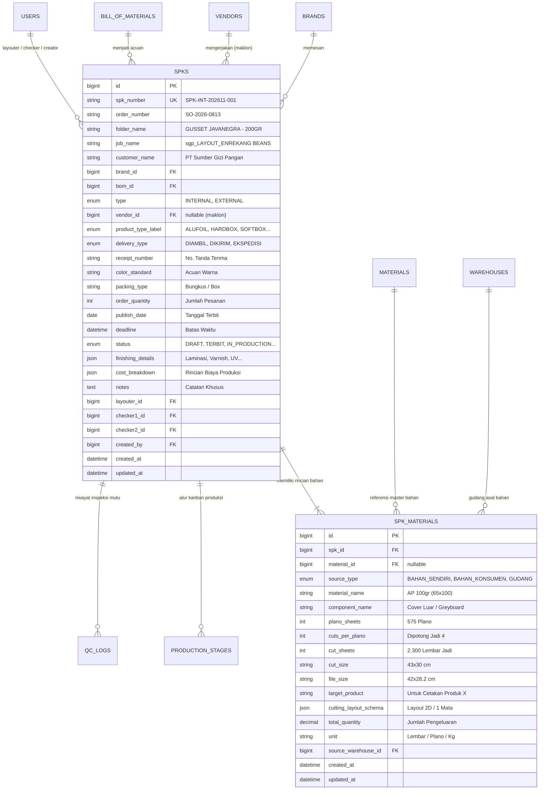
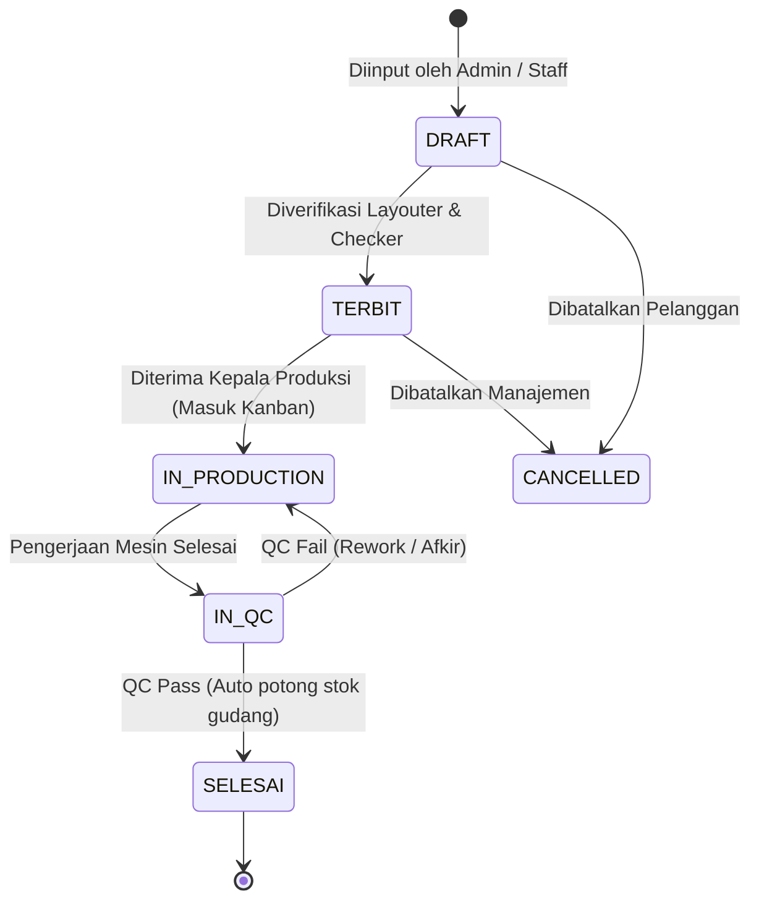

# DOKUMENTASI TEKNIS SISTEM: MODUL SPK (SURAT PERINTAH KERJA)
**PackSolution ERP & CRM Percetakan / Packaging**  
*Dokumen ini dirancang sebagai referensi teknis komprehensif bagi developer dan AI Agent untuk memahami arsitektur data, relasi tabel, kamus data (data dictionary), aturan bisnis (business rules), serta kontrak API pada modul SPK.*

---

## 1. Ringkasan Eksekutif & Konteks Modul

Modul **SPK (Surat Perintah Kerja)** adalah inti operasional manufaktur dalam sistem ERP PackSolution. Dokumen SPK bertindak sebagai jembatan legal dan teknis yang menghubungkan pesanan penjualan (*Sales Order / BOM*) dengan lantai pabrik (*Kanban Produksi*), pengawasan mutu (*Quality Control*), dan logistik gudang (*Inventory Allocation*).

### Fitur Kunci:
1. **Dual-Routing Produksi:**
   - **SPK Internal (`INTERNAL`):** Dikerjakan in-house menggunakan mesin internal percetakan (Komori offset, digital printing, mesin pond, laminating).
   - **SPK Eksternal / Maklon (`EXTERNAL`):** Didelegasikan kepada vendor mitra maklon terdaftar (`vendors`) dengan pengawasan PO eksternal dan tracking surat jalan.
2. **Normalisasi Multi-Bahan Baku (`spk_materials`):**
   - Produk packaging (misalnya *Hardbox*, *Softbox*, *Standing Pouch Alufoil*) bersifat *multi-component*. Satu produk jadi dapat tersusun atas lembaran greyboard, kertas cover (Art Paper), plastik lining, lem, dan foil hot-stamping.
   - Setiap komponen bahan baku dicatat dalam baris terpisah dengan ukuran plano, skema potong, dan gudang asal pengeluarannya.
3. **Kalkulasi & Skema Potong Percetakan (Cutting Scheme):**
   - Mendokumentasikan rasio plano ke lembar siap cetak ($Plano \times Cuts = Lembar\,Potong$).
   - Menyimpan visualisasi/skema potongan 2D dalam bentuk JSON (`cutting_layout_schema`).

---

## 2. Diagram Relasi Entitas (ERD)



---

## 3. Kamus Data & Spesifikasi Field (Data Dictionary)

### 3.1. Tabel `spks` (Master Header SPK)

| Nama Field | Tipe Data | Nullable | Default | Keterangan / Validasi |
| :--- | :--- | :--- | :--- | :--- |
| `id` | `bigint unsigned` | NO | Auto Increment | Primary Key. |
| `spk_number` | `varchar(64)` | NO | - | Nomor unik SPK (Unique, Indexed). Format: `SPK-INT-YYYYMM-XXX` atau `SPK-EKS-YYYYMM-XXX`. |
| `order_number` | `varchar(64)` | YES | `NULL` | Nomor Surat Pesanan / Sales Order acuan (Indexed). |
| `folder_name` | `varchar(150)` | YES | `NULL` | Nama folder arsip desain (cth: `"GUSSET JAVANEGRA - 200GR"`). |
| `job_name` | `varchar(200)` | YES | `NULL` | Nama spesifik pekerjaan cetak (cth: `"sgp_LAYOUT_ENREKANG BEANS 200GR#130826"`). |
| `customer_name`| `varchar(150)` | YES | `NULL` | Nama pelanggan atau perusahaan pemesan. |
| `brand_id` | `bigint unsigned` | YES | `NULL` | Foreign Key ke tabel `brands.id` (`onDelete: set null`). |
| `bom_id` | `bigint unsigned` | YES | `NULL` | Foreign Key ke tabel `bill_of_materials.id` (`onDelete: set null`). |
| `type` | `enum` | NO | `'INTERNAL'` | Opsi: `'INTERNAL'`, `'EXTERNAL'`. Menentukan jalur in-house vs maklon vendor. |
| `vendor_id` | `bigint unsigned` | YES | `NULL` | Foreign Key ke tabel `vendors.id` (wajib diisi jika `type = 'EXTERNAL'`). |
| `product_type_label` | `enum` | NO | `'ALUFOIL'` | Opsi: `'ALUFOIL'`, `'HARDBOX'`, `'SOFTBOX'`, `'CORRUGATED'`, `'LABEL_STICKER'`, `'OTHERS'`. Badge kategori produk. |
| `delivery_type`| `enum` | NO | `'DIAMBIL'` | Opsi: `'DIAMBIL'`, `'DIKIRIM'`, `'EKSPEDISI'`. Metode penyerahan barang jadi. |
| `receipt_number` | `varchar(100)` | YES | `NULL` | Nomor tanda terima penyerahan barang / Surat Jalan. |
| `color_standard` | `varchar(150)` | NO | `'Standart Martin / Indicator'` | Acuan toleransi warna percetakan. |
| `packing_type` | `varchar(100)` | NO | `'Bungkus'` | Tipe kemasan akhir (cth: `"Bungkus"`, `"Karton Box"`, `"Pallet"`). |
| `order_quantity` | `unsigned int` | NO | `1000` | Target total cetakan produk jadi. |
| `publish_date` | `date` | YES | `CURRENT_DATE` | Tanggal resmi penerbitan SPK (Indexed). Digunakan untuk filter rentang tanggal. |
| `deadline` | `datetime` | YES | `NULL` | Batas akhir penyelesaian produksi (Indexed). |
| `status` | `enum` | NO | `'DRAFT'` | Opsi: `'DRAFT'`, `'TERBIT'`, `'IN_PRODUCTION'`, `'SELESAI'`, `'CANCELLED'`. |
| `finishing_details` | `json` | YES | `NULL` | Struktur JSON memuat instruksi laminasi, spot UV, hot stamping/foil, emboss, dll. |
| `cost_breakdown` | `json` | YES | `NULL` | Struktur JSON kalkulasi biaya: bahan, cetak, potong, laminasi, plat, dll. |
| `notes` | `text` | YES | `NULL` | Catatan khusus instruksi operator mesin / peringatan teknis. |
| `layouter_id` | `bigint unsigned` | YES | `NULL` | Foreign Key ke `users.id` (Operator layout yang menyiapkan file kerja). |
| `checker1_id` | `bigint unsigned` | YES | `NULL` | Foreign Key ke `users.id` (Pemeriksa pertama / Kepala Divisi Pracetak). |
| `checker2_id` | `bigint unsigned` | YES | `NULL` | Foreign Key ke `users.id` (Pemeriksa kedua / Kepala Produksi). |
| `created_by` | `bigint unsigned` | YES | `NULL` | Foreign Key ke `users.id` (Pembuat dokumen SPK). |
| `created_at` | `timestamp` | YES | `CURRENT_TIMESTAMP` | Waktu data dibuat. |
| `updated_at` | `timestamp` | YES | `CURRENT_TIMESTAMP` | Waktu data terakhir diperbarui. |

---

### 3.2. Struktur JSON Field Khusus pada `spks`

#### A. Field `finishing_details` (Instruksi Finishing & Laminasi)
```json
{
  "laminasi": {
    "jenis": "THERMAL",
    "tipe": "Laminasi DOFF",
    "muka": "1 Muka",
    "keterangan": "Sisi luar box"
  },
  "spot_uv": {
    "active": true,
    "keterangan": "+LAMINASI SPOT UV pada logo"
  },
  "foil": {
    "active": true,
    "kode_foil": "FOIL RG 603",
    "keterangan": "Hot stamping emas merkuri"
  },
  "coating": {
    "tipe": "WATERBASE GLOSSY"
  },
  "cetak": {
    "mesin": "KOMORI",
    "set": 1,
    "model_cetak": "4/0",
    "order_lembar_cetak": 2100,
    "insheet": 200,
    "jumlah_plat": 4,
    "keterangan": "Inksheet aman untuk kalibrasi warna"
  }
}
```

#### B. Field `cost_breakdown` (Rincian Biaya Estimasi & Aktual)
```json
{
  "bahan": 4500000,
  "cetak": 1250000,
  "biaya_potong_bahan": 150000,
  "overprint": 0,
  "potong_jadi": 100000,
  "laminasi": 850000,
  "uv_spot": 400000,
  "proff": 50000,
  "vendor_subcon": 0,
  "total_estimasi": 7300000
}
```

---

### 3.3. Tabel `spk_materials` (Detail Multi-Bahan Baku)

Tabel ini menampung kebutuhan bahan baku relasional $1:N$ terhadap `spks`. Jika sebuah box packaging memerlukan kertas cover luar dan board tebal di dalam, kedua material tercatat sebagai entitas mandiri.

| Nama Field | Tipe Data | Nullable | Default | Keterangan & Rumus Teknis |
| :--- | :--- | :--- | :--- | :--- |
| `id` | `bigint unsigned` | NO | Auto Increment | Primary Key. |
| `spk_id` | `bigint unsigned` | NO | - | Foreign Key ke `spks.id` (`onDelete: cascade`). |
| `material_id` | `bigint unsigned` | YES | `NULL` | Foreign Key ke katalog master `materials.id` (`onDelete: set null`). |
| `source_type` | `enum` | NO | `'BAHAN_SENDIRI'` | Opsi: `'BAHAN_SENDIRI'`, `'BAHAN_KONSUMEN'`, `'GUDANG'`. |
| `material_name` | `varchar(150)` | NO | - | Spesifikasi bahan (cth: `"AP 100gr (65x100)"`, `"Ivory 300gr"`, `"Greyboard No. 30"`). |
| `component_name`| `varchar(100)` | YES | `NULL` | Bagian packaging (cth: `"Cover Luar"`, `"Kerangka Box"`, `"Sleeve"`). |
| `plano_sheets` | `unsigned int` | NO | `0` | Jumlah lembar bahan baku ukuran plano utuh (cth: `575`). |
| `cuts_per_plano`| `unsigned int` | NO | `1` | Berapa lembar potongan yang dihasilkan dari 1 lembar plano (cth: `4`). |
| `cut_sheets` | `unsigned int` | NO | `0` | Total lembar siap cetak. **Rumus:** $plano\_sheets \times cuts\_per\_plano$ (cth: $575 \times 4 = 2.300$). |
| `cut_size` | `varchar(50)` | YES | `NULL` | Dimensi lembar siap cetak (cth: `"43x30 cm"`). |
| `file_size` | `varchar(50)` | YES | `NULL` | Dimensi area desain cetak termasuk bleed (cth: `"42x28.2 cm"`). |
| `target_product`| `varchar(200)` | YES | `NULL` | Peruntukan cetak spesifik (cth: `"GFB ENREKANG BEANS 200GR (Ziplock Pocket)"`). |
| `cutting_layout_schema` | `json` | YES | `NULL` | Data koordinat / grid pembagian potong (cth: `{"layout": "1 MATA", "grid": "2x2"}`). |
| `total_quantity`| `decimal(10,2)`| NO | `0.00` | Kuantitas bahan yang harus dikeluarkan dari stok gudang. |
| `unit` | `varchar(30)` | NO | `'Lembar'` | Satuan barang (cth: `"Lembar"`, `"Plano"`, `"Roll"`, `"Kg"`). |
| `source_warehouse_id` | `bigint unsigned` | YES | `NULL` | Foreign Key ke `warehouses.id`. Gudang yang stoknya akan dipotong otomatis. |
| `created_at` | `timestamp` | YES | `CURRENT_TIMESTAMP` | Waktu data dibuat. |
| `updated_at` | `timestamp` | YES | `CURRENT_TIMESTAMP` | Waktu data terakhir diubah. |

---

## 4. Arsitektur Kode Backend (Laravel 11)

### 4.1. Lokasi Berkas Utama

```
backend/
├── app/
│   ├── Http/
│   │   └── Controllers/
│   │       └── Api/
│   │           └── V1/
│   │               └── SpkController.php     <-- HTTP Request/Response Handler
│   ├── Models/
│   │   ├── Spk.php                           <-- Eloquent Model Header SPK
│   │   └── SpkMaterial.php                   <-- Eloquent Model Detail Bahan
│   └── Services/
│       └── SpkService.php                    <-- Business Logic & Atomic Transactions
├── database/
│   └── migrations/
│       ├── 2026_11_15_000001_create_spks_table.php
│       └── 2026_11_15_000002_create_spk_materials_table.php
└── routes/
    └── api.php                               <-- Endpoint Routing
```

### 4.2. Logika Bisnis & Fitur Unggulan `SpkService.php`

1. **Auto-Numbering Generator:**
   - Format: `SPK-{TIPE}-{YYYYMM}-{001}` (Contoh: `SPK-INT-202611-001` atau `SPK-EKS-202611-001`).
   - Nomor running otomatis direset atau berlanjut per bulan berjalan.
2. **ACID Transaction Integrity:**
   - Pembuatan data header `spks` dan seluruh array item `spk_materials` dibungkus dalam blok `DB::transaction()`. Jika salah satu gagal, seluruh operasi di-rollback.
3. **Comprehensive Query Filtering (Siap Menghubungkan DataFilterBar):**
   - Mendukung parameter:
     - `type`: `INTERNAL` / `EXTERNAL`
     - `brand_id` atau `brand` (pencarian nama/slug brand)
     - `status`: `DRAFT`, `TERBIT`, `IN_PRODUCTION`, `SELESAI`, `CANCELLED`
     - `product_type_label`: `ALUFOIL`, `HARDBOX`, dll.
     - `delivery_type`: `DIAMBIL`, `DIKIRIM`, `EKSPEDISI`
     - `start_date` & `end_date`: Filter berdasarkan kolom `publish_date`
     - `q` / `keyword`: Pencarian fuzzy pada nomor SPK, nama job, nama folder, nama customer, dan nama bahan baku.

---

## 5. Kontrak API (API Specifications)

### 5.1. Ringkasan Endpoint

| Method | Endpoint | Hak Akses (Role) | Fungsi |
| :--- | :--- | :--- | :--- |
| `GET` | `/api/v1/spk` | `kepala_produksi`, `operator`, `sales`, `admin` | Daftar SPK (mendukung filter bar & paginasi) |
| `POST` | `/api/v1/spk` | `kepala_produksi`, `admin`, `operator` | Penerbitan SPK baru + Multi-Bahan |
| `GET` | `/api/v1/spk/{id}` | Semua role terotorisasi | Detail lengkap SPK beserta relasi |
| `PUT` | `/api/v1/spk/{id}` | `kepala_produksi`, `admin` | Pembaruan data SPK dan sinkronisasi bahan |
| `PATCH` | `/api/v1/spk/{id}/status` | `kepala_produksi`, `quality_control` | Transisi status SPK |
| `DELETE` | `/api/v1/spk/{id}` | `kepala_produksi`, `admin` | Pembatalan / soft-delete SPK |

---

### 5.2. Contoh Payload `POST /api/v1/spk`

```json
{
  "order_number": "SO-20260813-09",
  "folder_name": "GUSSET JAVANEGRA - 200GR",
  "job_name": "sgp_LAYOUT_ENREKANG BEANS 200GR#130826",
  "customer_name": "PT Sumber Gizi Pangan",
  "brand_id": 3,
  "bom_id": 12,
  "type": "INTERNAL",
  "product_type_label": "ALUFOIL",
  "delivery_type": "DIAMBIL",
  "order_quantity": 2100,
  "publish_date": "2026-11-15",
  "deadline": "2026-11-20 17:00:00",
  "color_standard": "Standart Martin / Indicator",
  "packing_type": "Bungkus",
  "notes": "Pastikan seal kantong rapat dan tidak berkerut",
  "finishing_details": {
    "laminasi": {
      "jenis": "THERMAL",
      "tipe": "Laminasi DOFF",
      "muka": "1 Muka"
    },
    "spot_uv": { "active": true, "keterangan": "Logo depan" },
    "foil": { "active": true, "kode_foil": "FOIL RG 603" },
    "coating": { "tipe": "WATERBASE GLOSSY" }
  },
  "cost_breakdown": {
    "bahan": 4200000,
    "cetak": 1200000,
    "potong": 150000,
    "laminasi": 600000
  },
  "materials": [
    {
      "material_id": 15,
      "source_type": "BAHAN_SENDIRI",
      "material_name": "AP 100gr (65x100)",
      "component_name": "Cetak Muka Alufoil",
      "plano_sheets": 575,
      "cuts_per_plano": 4,
      "cut_sheets": 2300,
      "cut_size": "43x30",
      "file_size": "42x28.2",
      "target_product": "GFB ENREKANG BEANS 200GR (Ziplock Pocket + Valve)",
      "cutting_layout_schema": {
        "layout_mode": "LAYOUT 1 MATA",
        "grid_cols": 2,
        "grid_rows": 2
      },
      "total_quantity": 575.00,
      "unit": "Plano",
      "source_warehouse_id": 1
    }
  ]
}
```

---

## 6. Siklus Hidup Dokumen (Lifecycle & State Machine)



1. **DRAFT:** Dokumen baru dibuat, data teknis masih bisa diubah bebas oleh operator/layouter.
2. **TERBIT:** Dokumen telah disahkan oleh `layouter_id`, `checker1_id`, dan `checker2_id`. Nomor SPK resmi terbit dan siap masuk antrean produksi.
3. **IN_PRODUCTION:** Dokumen masuk ke papan **Kanban Produksi** (`production_stages`) dan dialokasikan ke mesin cetak / finishing terkait.
4. **IN_QC / SELESAI:** Produk selesai diproduksi dan diinspeksi oleh modul **Quality Control** (`qc_logs`). Begitu status diset `SELESAI`, kuantitas bahan baku pada `spk_materials` otomatis memotong stok fisik pada `warehouses`.
5. **CANCELLED:** SPK dibatalkan, alokasi mesin dan reservasi material dilepaskan.

---

## 7. Pedoman bagi Pengembang & Agen AI Selanjutnya

Jika Anda atau AI lain melanjutkan pengembangan modul terkait:
1. **Penyambungan ke Kanban Produksi (`production_stages`):**
   - Gunakan `spk_id` sebagai *foreign key* utama di tabel tahapan produksi.
   - Ambil nilai `deadline`, `publish_date`, `job_name`, `customer_name`, dan `order_quantity` dari relasi `$spk->order_quantity`.
2. **Penyambungan ke Quality Control (`qc_checklist_templates` & `qc_logs`):**
   - Saat QC menginspeksi produk, rujuk `spks.product_type_label` (misal `ALUFOIL` atau `HARDBOX`) dan `spks.brand_id` untuk memilih preset checklist pertanyaan QC yang sesuai secara otomatis.
3. **Perubahan Field ENUM:**
   - Jika ingin menambah kategori produk pada `product_type_label`, lakukan via file migrasi tambahan (`ALTER TABLE spks MODIFY COLUMN product_type_label ...`) dan perbarui properti validasi di `SpkService` & `SpkController`.
4. **Integrasi Frontend (`frontend/src/app/dashboard/spk/page.tsx`):**
   - Komponen `DataFilterBar` telah dipasang di halaman ini. Hubungkan pemanggilan API `useQuery` atau `fetch` ke endpoint `/api/v1/spk` dengan meneruskan filter object:
     `{ brand_id, type, status, start_date, end_date, q }`.

---
*Dokumen ini dibuat secara otomatis dan terverifikasi sesuai skema database aktif per 15 November 2026.*
